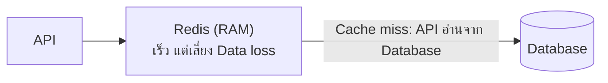

## Redis คืออะไร

In-memory data store เป็นที่เก็บข้อมูลใน Memory หรือ RAM = เร็วมากๆๆๆ

- Key-value structures
- นิยมใช้เป็น Cache (Caching layer) เพื่อลดการอ่านข้อมูลจาก Database ซ้ำๆ
- ใช้เป็น Primary database ในบางกรณีได้ เช่น Session store เก็บสถานะการล็อกอิน, Leaderboard เก็บคะแนนและอันดับด้วย Sorted Set

## API -> Redis -> database
ตัวอย่างที่ดีของการทำ Caching layer



## Redis Data types
อย่างที่บอกไปว่ามันเป็น Key-value structures ที่มี datatype ดังต่อไปนี้
- Strings เช่น `name -> 'mario'`
- Sets ไม่มีลำดับ สมาชิกไม่ซ้ำ เช่น `names -> {'mario', 'luigi', 'peach'}`
- Sorted sets เรียงตาม score สมาชิกไม่ซ้ำ เช่น `scores -> {'mario' -> 100, 'luigi' -> 80, 'peach' -> 120}` ใช้ทำ Leaderboard ได้
- Hash เช่น
```text
book -> {
    title -> 'final empire'
    author -> 'Brandon Sanderson'
}
```
- List เป็นคล้ายๆ Array แต่ซ้ำได้ มีลำดับแน่นอน ไม่เหมือน Sets เช่น `names -> ['mario', 'luigi', 'mario']`
- Stream เก็บ Event เป็นรายการต่อท้าย โดยแต่ละรายการมี ID และข้อมูลแบบ Field-value เช่น เหตุการณ์สร้างและชำระเงินของ Order

```text
orders ->
    1710000000000-0 -> {order_id -> '101', status -> 'created'}
    1710000001000-0 -> {order_id -> '101', status -> 'paid'}
```
> จริงๆ ผมอยากจะบอกว่า team:a แบบนี้ก็ถือเป็น key นะครับ ไม่ใช่ key = team และ value a คือ redis เขาก็มี sytnx ของเขาแหละครับ จริงๆ ก็ไม่ใช่ -> ด้วยครับ เพราะมันไม่เครื่องหมายเลย เดี๋ยวบทสองเห็นภาพครับ

ตัวอย่างนี้เป็นภาพรวมของข้อมูลใน Stream โดย ID ใช้เรียงลำดับรายการ โปรแกรมสามารถอ่าน Event ไปประมวลผล เช่น ส่งอีเมลหลังชำระเงิน และใช้ Consumer group เพื่อแบ่งงานให้หลาย Worker ได้

จริงๆ มี Datatype อื่นๆ ด้วยแต่แค่ให้เห็นว่าใช้ทำอะไร ไม่มีตัวอย่างแล้วกัน

- Bitmaps เก็บสถานะแบบบิต 0 หรือ 1 ช่วยประหยัดพื้นที่เมื่อมีสถานะจำนวนมาก
- Bitfields เก็บตัวเลขหลายค่าไว้ในระดับบิต โดยกำหนดจำนวนบิตของแต่ละค่าได้
- Geospatial indexes เก็บพิกัดและค้นหาตำแหน่งที่อยู่ใกล้กัน
- HyperLogLog ประมาณจำนวนสมาชิกที่ไม่ซ้ำกัน โดยใช้หน่วยความจำเพียงเล็กน้อย แต่ไม่ได้ให้ค่าที่แม่นยำ 100%
- JSON เก็บข้อมูลแบบ Object และ Array ที่ซ้อนกันได้ และเข้าถึงหรือแก้ไขเฉพาะบางส่วนได้
- Time series เก็บค่าพร้อมเวลา เหมาะกับข้อมูลที่ต้องติดตามการเปลี่ยนแปลงตามเวลา
- Vector sets เก็บและค้นหา Vector ที่คล้ายกัน เหมาะกับงาน Semantic search และระบบแนะนำข้อมูล
- Bloom filter และ Cuckoo filter ตรวจว่าสมาชิกอาจมีอยู่ในชุดข้อมูลหรือไม่ โดยใช้พื้นที่น้อย แต่มีโอกาสแจ้งว่ามีทั้งที่ไม่มีจริง
- Count-min sketch ประมาณความถี่ของข้อมูล, Top-K หารายการที่พบบ่อย และ t-digest ประมาณค่า Percentile
- Arrays เก็บรายการ String ที่เข้าถึงด้วย Index ได้ และเว้นช่องที่ไม่มีข้อมูลได้

การรองรับแต่ละชนิดขึ้นอยู่กับเวอร์ชันและส่วนเสริมที่ติดตั้ง ดูรายละเอียดเพิ่มเติมได้ที่ [Redis Data types](https://redis.io/docs/latest/develop/data-types/)


